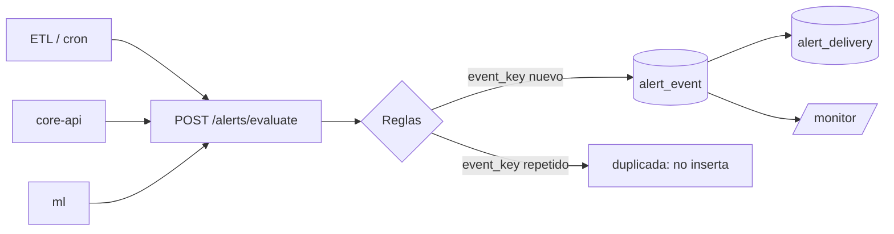

# Alertas y automatizacion

- **Tarea:** T13
- **Servicio:** `services/alerting`
- **Puerto:** 8004
- **Dependencias:** `core-api` (8000) y `ml` (8002); sin conexion a SQL Server
- **Evidencia:** `documentation/evidencias/T13_alerting.md`

---

## 1. Objetivo

Detectar desvios de negocio, de calidad de datos y del modelo predictivo; generar
alertas **sin duplicados**, registrar la entrega al canal y publicar una vista de
monitoreo operativo.

El motor no mide la base directamente: lee las metricas ya calculadas por
`core-api` y `ml`. Asi se respeta la regla de que solo `core-api` habla con SQL
Server.

---

## 2. Reglas implementadas

| Codigo | Tipo | Severidad | Condicion | Origen |
|---|---|---|---|---|
| `VENTAS_BAJAS` | regla_negocio | warning | Ventas del periodo < S/ 1000 | `core-api /api/v1/kpis` |
| `TICKET_BAJO` | regla_negocio | warning | Ticket promedio < S/ 200 | `core-api /api/v1/kpis` |
| `CAIDA_VENTAS` | regla_negocio | critical | Caida > 15 % vs periodo anterior | `core-api /api/v1/tendencias` |
| `MODELO_SIN_ENTRENAR` | umbral_ml | info | Menos de 8 periodos o estado distinto de `trained` | `ml /model` |
| `MAE_ALTO` | umbral_ml | warning | MAE del modelo > 500 | `ml /model` |
| `RECHAZOS_ALTOS` | calidad_datos | critical | Rechazos abiertos > 10 | `core-api /api/v1/monitor` |

Umbrales configurables por `.env`:

| Variable | Default |
|---|---|
| `ALERT_VENTAS_MIN` | 1000 |
| `ALERT_TICKET_MIN` | 200 |
| `ALERT_CAIDA_PCT` | 15 |
| `ALERT_MAE_MAX` | 500 |
| `ALERT_RECHAZOS_MAX` | 10 |

Con la fuente actual se disparan exactamente `VENTAS_BAJAS` (696.40), `TICKET_BAJO`
(174.10) y `MODELO_SIN_ENTRENAR` (1 periodo vs 8). No se disparan `CAIDA_VENTAS`
(no hay periodo previo comparable), `MAE_ALTO` (no hay modelo) ni `RECHAZOS_ALTOS`
(0 rechazos).

---

## 3. Contenido de una alerta

`alert_id`, `created_at`, `rule_code`, `alert_type`, `severity`, `entity`,
`indicator`, `observed_value`, `threshold`, `period`, `source`, `explanation`,
`action`, `status`, `simulated` y `event_key`.

Toda alerta explica **que paso**, **contra que umbral** y **que accion tomar**.
No se genera una alerta sin valor observado, umbral, periodo y origen.

---

## 4. Anti-duplicado

```
event_key = regla | entidad | periodo | data_updated_at
```

- `alert_event.event_key` es `UNIQUE` en SQLite; el insert usa `INSERT OR IGNORE`.
- Si la misma condicion se evalua dos veces sobre los mismos datos, la segunda
  evaluacion informa `nuevas=0` y `duplicadas=N`.
- `alert_delivery` es unica por `(alert_id, channel)`: tampoco se repite la
  entrega.

Ejemplo real: primera evaluacion `3 nuevas`, segunda `0 nuevas / 3 duplicadas`.

---

## 5. Canal y registro de entrega

| Elemento | Implementacion |
|---|---|
| Canal | Vista dashboard `GET /monitor` (HTML) y `GET /monitor.json` |
| Registro | Tabla `alert_delivery` (`channel='dashboard'`, `status='delivered'`) |
| Almacenamiento | SQLite local `services/alerting/data/alerts.db` (fuera del repo) |
| Aislamiento en pruebas | `ALERT_DB_PATH` apunta a una base temporal |

No se configuro SMTP ni WebSocket. El canal elegido cumple el requisito de
notificar y dejar registro verificable de la entrega.

---

## 6. Automatizacion

- **Bajo demanda:** `POST /alerts/evaluate` o `python -m app evaluate`.
- **Scheduler:** no hay uno propio; en produccion el paso se encadena al cierre
  del ETL o a un cron. El comando es idempotente, por lo que puede repetirse sin
  generar ruido.
- **Simulacion:** `POST /alerts/simulate` crea una alerta marcada `simulated=1`
  para probar el canal sin confundirla con una real. Se excluye con
  `GET /alerts?incluir_simuladas=false`.
- **Reconocimiento:** `POST /alerts/{id}/ack` deja `status='acknowledged'` y
  `acknowledged_at`.



---

## 7. Contratos

| Metodo | Ruta | Descripcion |
|---|---|---|
| GET | `/health` | Estado propio, `core-api`, ML y total de alertas |
| GET | `/rules` | 6 reglas y umbrales vigentes |
| POST | `/alerts/evaluate` | Evalua y registra solo alertas nuevas |
| GET | `/alerts` | Listado (`status`, `severity`, `limit`, `incluir_simuladas`) |
| GET | `/alerts/{id}` | Detalle con entregas |
| POST | `/alerts/{id}/ack` | Reconoce la alerta |
| POST | `/alerts/simulate` | Alerta de prueba identificada |
| GET | `/monitor` | Vista HTML de monitoreo |
| GET | `/monitor.json` | Snapshot de pipeline, modelo y notificaciones |

La vista `/monitor` muestra: ultima carga, ejecuciones de 24 h, fallas, rechazos
por regla, estado del modelo y ultimas alertas con su severidad y entrega.

---

## 8. Fallas controladas

| Situacion | Comportamiento |
|---|---|
| `core-api` caido | `/health` queda `degraded` y `POST /alerts/evaluate` devuelve 503; no inventa alertas |
| `ml` caido | Se informa como no disponible; no se evaluan reglas de ML |
| SQLite bloqueado | La operacion falla de forma visible; no pierde la alerta ya registrada |
| Datos sin cambios | Reevaluar no duplica (mismo `event_key`) |

---

## 9. Pruebas

```powershell
python tests/test_alerting_rules.py      # reglas puras + store (sin servicios)
python tests/smoke_alerting.py           # end-to-end con core-api y ml
```

Cubren: disparo por contexto, no disparo en contexto sano, contenido minimo,
anti-duplicado, entrega unica, reconocimiento, simulacion marcada, `/monitor.json`
y `/monitor` HTML.

---

## 10. Limites

- La evaluacion no es en tiempo real: se ejecuta bajo demanda o por scheduler.
- `CAIDA_VENTAS` queda muda mientras exista un solo periodo con ventas; es
  correcto, no se inventa una comparacion.
- El canal es el dashboard; no hay correo ni push.
- SQLite reserva el id aunque `INSERT OR IGNORE` no inserte; por eso una
  simulacion posterior puede tener un id mayor que el total de alertas.
