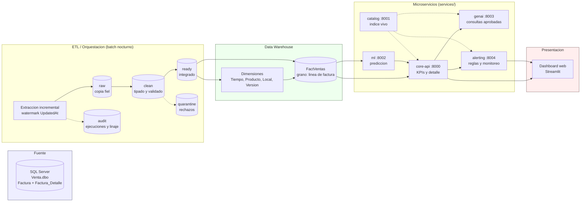

# Arquitectura de la solucion

- **Proyecto:** Plataforma Integral de Ingenieria de Datos y Analitica Inteligente
- **Proceso de negocio:** VENTAS (unico proceso en alcance)
- **Version:** 1.0 - cierre de Sprint 0
- **Tarea:** T03

---

## 1. Alcance

La plataforma cubre el ciclo completo de analitica sobre **ventas minoristas**:

1. Extraccion del sistema transaccional de ventas.
2. Staging en tres zonas con trazabilidad y cuarentena.
3. Carga a un Data Warehouse dimensional (esquema estrella).
4. Publicacion de KPIs por API.
5. Dashboard web con filtros, tendencias y detalle.
6. Modelo predictivo de ventas con baseline.
7. Asistente de lenguaje natural con consultas controladas.
8. Alertas automaticas y vista de monitoreo.

### 1.1 Dentro del alcance

- Lineas de factura de venta, productos y su jerarquia comercial
  (Seccion > Rubro > Categoria > Familia > SubFamilia), locales y versiones de sistema.
- KPIs descriptivos calculados **exclusivamente** desde el Data Warehouse.
- Un batch de actualizacion diario.

### 1.2 Fuera del alcance (no-alcance explicito)

| Fuera de alcance | Motivo |
|---|---|
| Compras, stock, tesoreria, contabilidad | Regla de oro: un solo proceso de negocio |
| Tiempo real / streaming | El batch nocturno no es tiempo real; no se promete |
| Facturacion electronica o integracion fiscal | El sistema fuente ya la resuelve |
| Gestion de usuarios y seguridad corporativa | Se usa autenticacion basica del despliegue |
| Prediccion de demanda por SKU individual | Volumen y calidad de datos insuficientes |
| App movil nativa | El dashboard es responsive, no hay app nativa |

---

## 2. Diagrama de arquitectura

Regla estructural: **el frontend nunca se conecta directo a SQL Server**. Todo pasa por la API.
El servicio `catalog` publica el indice vivo en `/index.md` (servicios, carpetas,
funciones y rutas) y se documenta en ADR-007.

---

## 3. Capas y responsabilidades

| Capa | Responsabilidad | Artefacto | Frecuencia |
|---|---|---|---|
| Fuente | Sistema transaccional de ventas | `Venta` (SQL Server) | continua |
| Extraccion | Leer cambios por watermark, registrar auditoria | `etl/` | diaria 02:00 |
| Staging raw | Copia fiel, solo se agrega, nunca se sobrescribe | esquema `raw` | diaria |
| Staging clean | Tipado, limpieza, reglas de calidad, cuarentena | esquema `clean` | diaria |
| Staging ready | Integracion lista para el DW | esquema `ready` | diaria |
| DW | Esquema estrella con claves sustitutas | esquema `dw` | diaria |
| API | KPIs, tendencias, filtros y detalle | `services/core-api/` | bajo demanda |
| Dashboard | Visualizacion y drill-down | `services/dashboard/` | bajo demanda |
| ML | Prediccion de ventas por periodo | `services/ml/` | semanal |
| GenAI | Preguntas en lenguaje natural sobre vistas aprobadas | `services/genai/` | bajo demanda |
| Alertas | Reglas sobre KPIs y predicciones | `services/alerting/` | diaria |
| Catalogo | Indice vivo de servicios y rutas | `services/catalog/` | bajo demanda |

---

## 4. Definicion de "tiempo real"

El pipeline es **batch**. La latencia maxima esperada es de **24 horas**
(ultima corrida 02:00). El dashboard muestra siempre la marca de ultima
actualizacion y **no** presenta los datos como tiempo real.

---

## 5. Stack y versiones

| Componente | Herramienta | Version objetivo | Estado local |
|---|---|---|---|
| Motor de datos | SQL Server Developer/Express | 2019+ (16.x) | instalado y corriendo |
| Lenguaje ETL | Python | 3.12.x | 3.12.10 |
| Acceso a datos | pyodbc + SQLAlchemy | 5.x / 2.x | a instalar |
| Procesamiento | pandas | 2.2.x | a instalar |
| API | FastAPI + Uvicorn | 0.115.x | a instalar |
| Validacion | Pydantic | 2.x | a instalar |
| Dashboard | Streamlit + Plotly | 1.4x | a instalar |
| ML | scikit-learn | 1.5.x | a instalar |
| GenAI | Ollama local (modelo pequeño) + capa de consultas | - | opcional |
| Alertas | Python + tabla de eventos | - | - |
| Control de versiones | Git | 2.x | instalado |
| Contenedores | Docker Compose | - | **no instalado** (ver ADR-002) |

Las versiones exactas se fijan en `requirements.txt` durante el Sprint 1.

---

## 6. Decisiones tecnicas

Ver `documentation/adr/`:

| ADR | Decision |
|---|---|
| ADR-001 | Fuente de datos: SQL Server `Venta` |
| ADR-002 | Separacion de capas por esquemas en una instancia local |
| ADR-003 | Extraccion batch incremental por watermark e idempotencia |
| ADR-004 | Modelo dimensional estrella con grano linea de factura |
| ADR-005 | API FastAPI y frontend Streamlit desacoplado |
| ADR-006 | GenAI con consultas aprobadas, sin SQL libre |
| ADR-007 | Arquitectura de microservicios + catalogo de plataforma |

---

## 7. Ambientes

| Ambiente | Uso | Motor | Puerto |
|---|---|---|---|
| Local | Desarrollo y demo | SQL Server local | 1433 |
| API local | Pruebas y demo | Uvicorn | 8000 |
| Dashboard local | Pruebas y demo | Streamlit | 8501 |

No hay ambiente productivo: el alcance es academico y la demo es local.

---

## 8. Riesgos y mitigaciones

| Riesgo | Impacto | Mitigacion |
|---|---|---|
| Docker no disponible en el equipo | No se levanta el compose | Fuente local ya operativa; el compose queda como via alternativa documentada |
| Fuente con muy pocos registros (~5 facturas) | Analisis poco representativo | Generador de datos sinteticos etiquetados como simulacion |
| Data leakage en ML | Metricas invalidas | Division temporal, nunca aleatoria |
| Frontend acoplado a SQL | Incumple la regla de oro | Acceso solo por API |
| Cifras inventadas por la IA | Perdida de confianza | Whitelist de consultas y respuesta "sin datos suficientes" |
| Secretos en el repositorio | Penalizacion directa | `.env` fuera del repo y `.env.example` versionado |

---

## 9. Criterios de aceptacion (T03)

- [x] Diagrama de arquitectura general entregado.
- [x] Documento de decisiones con justificacion por tecnologia.
- [x] Alcance y no-alcance escritos.
- [x] Stack final definido (fuente, DW, ETL, backend, frontend, ML, GenAI).
- [x] Frecuencia de actualizacion declarada (batch diario 02:00, latencia < 24 h).
- [ ] Aprobacion del Product Owner (pendiente de Sprint Review).
