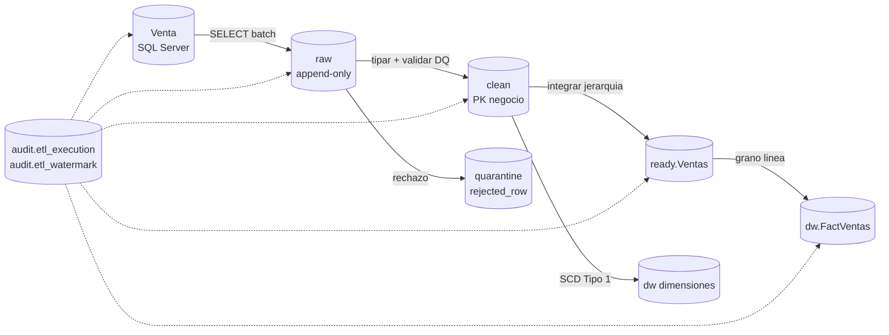
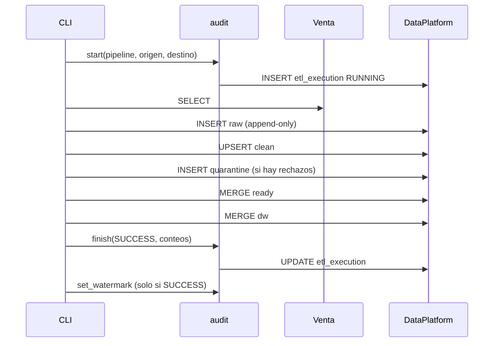

# ETL: extraccion, transformacion, carga y orquestacion

- **Tareas:** T05, T06, T08, T14
- **Servicio:** `services/etl`
- **Ejecucion:** `python -m app <comando>` desde `services/etl`
- **Zonas:** `raw` -> `clean` -> `ready` -> `dw` (ver `staging.md`)

---

## 1. Vision general



| Fase | Funcion | Destino | Idempotencia |
|---|---|---|---|
| Extraccion | `staging.extract` | `raw.*` | Append-only (crece a proposito) |
| Limpieza | `staging.clean` | `clean.*` + `quarantine` | UPSERT por clave de negocio |
| Integracion | `staging.build_ready` | `ready.Ventas` | MERGE por `Id_Factura_Detalle` |
| Carga DW | `dw.load` | `dw.*` | MERGE por clave natural |

---

## 2. Extraccion

- 10 objetos: `Factura`, `Factura_Detalle`, `Producto`, `Local`, `Version`,
  `Seccion`, `Rubro`, `Categoria`, `Familia`, `SubFamilia`.
- **Full:** `SELECT` completo de cada objeto.
- **Incremental:** para `Factura` y `Factura_Detalle` usa la columna `fecha` y el
  watermark guardado en `audit.etl_watermark`, con una ventana de solapamiento
  (`ETL_OVERLAP_DAYS`, por defecto 1 dia) para no perder bordes.
- Cada fila de `raw` guarda `_execution_id` y `_loaded_at`.
- `raw` nunca se actualiza ni se borra: es la copia fiel de lo extraido.

```powershell
python -m app full                      # carga inicial
python -m app incremental               # solo la ventana nueva
python -m app incremental --overlap-days 3
```

---

## 3. Transformacion y calidad

`staging.clean` aplica `quality.to_clean_row` y `quality.validate` con el catalogo
`DQ-001` a `DQ-015` (`documentation/calidad_datos.md`).

| Accion | Cuando | Destino |
|---|---|---|
| Normalizar | Trim, tipos, nulos controlados | `clean` |
| Aceptar | Cumple todas las reglas | `clean` |
| Rechazar | Viola una regla | `quarantine.rejected_row` |
| Completar jerarquia | Falta un nivel de producto | `Desconocido` (DQ-014) |

Reglas destacadas:

- `Cantidad > 0` y `PrecioUnitario >= 0`.
- `IdFactura` e `IdProducto` deben existir (integridad referencial).
- Fecha entre 2000-01-01 y hoy + 1.
- Duplicados del lote: se conserva el ultimo y se registra el rechazo.
- `VentaAsociada` no se usa como medida: la cabecera no cuadra con el detalle.

Ningun registro se descarta en silencio: o esta en `clean/ready/dw`, o esta en
cuarentena con su `rule_code`, `rule_detail` y `payload`.

---

## 4. Integracion (`ready`)

`build_ready` resuelve la jerarquia comercial completa y deja **una fila por linea
de factura** con:

`Id_Factura_Detalle`, `idFactura`, `NumeroFactura`, `fecha`, `IdLocal`,
`IdVersion`, `idProducto`, `Cantidad`, `PrecioUnitario`, `ImporteLinea`, jerarquia
de producto y local, mas `_execution_id`.

`ImporteLinea = Cantidad * PrecioUnitario`. El MERGE por clave de negocio hace
que reejecutar no duplique.

---

## 5. Carga del Data Warehouse

`dw.load` hace, en orden:

1. `DimTiempo` (2000-2035 + desconocido), determinista por `AAAAMMDD`.
2. `DimProducto`, `DimLocal`, `DimVersion` por clave natural (SCD Tipo 1).
3. `FactVentas` desde `ready.Ventas`, resolviendo claves sustitutas.
4. `dw.vw_Ventas` para consultas de la API.

Si un hecho no encuentra su dimension, se carga con clave `0` y se registra para
revision. Al final se cuentan huerfanos (`orphan_facts`), que deben ser **0**.

---

## 6. Orquestacion y auditoria



- Si una fase lanza una excepcion, `audit.run` cierra la fila en `FAILED` con
  `error_detail` y **no** avanza el watermark.
- El watermark se escribe **despues** de cerrar la corrida en `SUCCESS`
  (`staging.extract`), de modo que una falla obliga a reprocesar la ventana.
- `audit.row_lineage` registra el linaje por clave de negocio y operacion.

---

## 7. Operacion diaria

```powershell
python -m app status             # ultimas 12 ejecuciones + volumen por capa
python -m app idempotency-check  # ejecuta dos veces y compara conteos
python -m app quality-report     # regenera documentation/evidencias/T06_...
python -m app list-rules         # catalogo DQ
sqlcmd -S localhost -E -C -f 65001 -i ../../database/99_verify.sql
```

Monitoreo desde la plataforma:

```powershell
Invoke-RestMethod http://localhost:8000/api/v1/monitor
```

Devuelve ultima carga, ejecuciones de 24 h, fallas, rechazos por regla y filas
del hecho. Es la fuente de la vista `/monitor` del servicio de alertas.

---

## 8. Recuperacion ante fallas

| Falla | Deteccion | Recuperacion |
|---|---|---|
| Fuente caida | `FAILED` en `audit.etl_execution`, API 503 | Restablecer SQL Server y repetir `incremental`; el watermark no avanzo |
| Error de conexion al DW | Excepcion en la CLI | Verificar `.env` y `sqlcmd`; repetir la corrida |
| Filas rechazadas | `quarantine.rejected_row` con `status=PENDIENTE` | Corregir el dato o la regla, reprocesar la ventana (`--overlap-days`) y marcar `REPROCESADO` |
| Duplicados inesperados | `idempotency-check` con `CAMBIO` | Revisar la clave de negocio del MERGE antes de continuar |
| Huerfanos en el hecho | `orphan_facts > 0` o `99_verify.sql` | Cargar la dimension faltante y recargar el hecho |
| Ambiente corrupto | Conteos incoherentes | `database/98_reset.sql` y repetir los scripts + `full` (solo desarrollo) |

Prueba de recuperacion ejecutada: se forzo una conexion a una base inexistente
(`SOURCE_DATABASE=VentaNoExiste`); la corrida fallo sin escribir en `raw`, y la
siguiente corrida `incremental` termino `SUCCESS` manteniendo los conteos. Ver
`evidencias/T14_pruebas.md`.

---

## 9. Configuracion

| Variable | Default | Uso |
|---|---|---|
| `SOURCE_SERVER` / `SOURCE_DATABASE` | `localhost` / `Venta` | Fuente |
| `DW_SERVER` / `DW_DATABASE` | `localhost` / `DataPlatform` | Plataforma |
| `ETL_BATCH_SIZE` | 1000 | Tamano de lote |
| `ETL_OVERLAP_DAYS` | 1 | Solapamiento del incremental |
| `ETL_LOG_LEVEL` | INFO | Nivel de log |

Credenciales: autenticacion de Windows por defecto; si se usa usuario tecnico,
va en `.env` (nunca en el repositorio).
