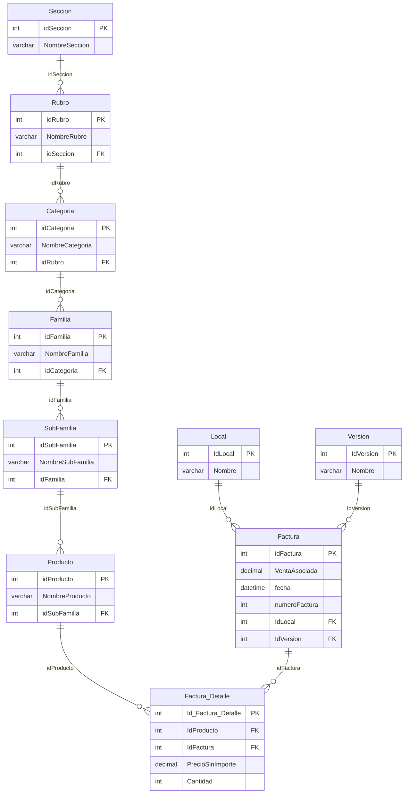

# Fuente de datos - Base `Venta`

- **Tareas:** T01, T02
- **Motor:** SQL Server local (`localhost`), base `Venta`
- **Acceso:** solo lectura (`SELECT`), autenticacion de Windows
- **Diagrama editable:** `documentation/fuente_datos.dbml` (dbdiagram.io)
- **Diccionario CSV:** `documentation/diccionario_fuente.csv`

---

## 1. Inventario

| Tabla | Filas | Rol |
|---|---|---|
| `dbo.Factura` | 5 | Cabecera de factura: fecha, local, version, numero |
| `dbo.Factura_Detalle` | 5 | Linea de factura: producto, cantidad, precio |
| `dbo.Producto` | 4 | Producto vendido |
| `dbo.Local` | 4 | Punto de venta |
| `dbo.Version` | 2 | Version del sistema (`REAL`, `PRESUPUESTO`) |
| `dbo.Seccion` | 4 | Nivel 1 de la jerarquia comercial |
| `dbo.Rubro` | 4 | Nivel 2 |
| `dbo.Categoria` | 5 | Nivel 3 |
| `dbo.Familia` | 4 | Nivel 4 |
| `dbo.SubFamilia` | 4 | Nivel 5 |
| `dbo.ProcesoCargaIncremental` | 4 | Marca de carga por local (no usada por el ETL) |
| `dbo.sysdiagrams` | 2 | Metadato de SQL Server Management Studio (no es negocio) |

Volumen total del proceso de ventas: **5 lineas**, **4 facturas distintas**,
**S/ 696.40**. Es una fuente de ejemplo, no un historico: solo hay un mes
(agosto 2008). Esta limitacion es la que obliga a que el modelo ML informe
`insufficient_data` en lugar de publicar metricas.

---

## 2. ERD

Todas las relaciones tienen FK fisica declarada en la base. No hay tabla de
clientes, empleados, descuentos ni geografia: el modelo dimensional se adapta a
lo que la fuente publica (ver `modelo_dimensional.md`, seccion 8).

---

## 3. Claves

| Tabla | PK | FK | Clave natural usada por el ETL |
|---|---|---|---|
| `Factura` | `idFactura` | `IdLocal` -> `Local`, `IdVersion` -> `Version` | `idFactura` |
| `Factura_Detalle` | `Id_Factura_Detalle` | `IdFactura` -> `Factura`, `IdProducto` -> `Producto` | `Id_Factura_Detalle` |
| `Producto` | `idProducto` | `idSubFamilia` -> `SubFamilia` | `idProducto` |
| `Local` | `IdLocal` | - | `IdLocal` |
| `Version` | `IdVersion` | - | `IdVersion` |
| `Seccion` / `Rubro` / `Categoria` / `Familia` / `SubFamilia` | `id*` | al nivel superior | `id*` |

No se detectaron duplicados de PK. `Factura` tiene 5 filas y 4 numeros de
factura distintos: la factura 4 aparece en dos fechas (2008-08-03 y 2008-08-15).

---

## 4. Diccionario de datos

### `dbo.Factura`

| Columna | Tipo | Nulo | Descripcion |
|---|---|---|---|
| `idFactura` | int | No | PK de la cabecera |
| `VentaAsociada` | decimal(18,0) | No | Importe declarado en la cabecera |
| `fecha` | datetime | No | Fecha de la venta |
| `nºFactura` | int | No | Numero visible de factura; se renombra a `NumeroFactura` en `raw` |
| `IdLocal` | int | Si | Local de la venta (FK) |
| `IdVersion` | int | Si | Version del sistema (FK) |

> **Inconsistencia detectada:** `SUM(VentaAsociada)` = **455.00**, mientras que
> `SUM(Cantidad * PrecioSinImporte)` = **696.40**. La cabecera no cuadra con el
> detalle. Por eso el ETL **no usa `VentaAsociada` como medida**; el importe
> sale siempre de las lineas. Documentado como hallazgo de perfilado.

### `dbo.Factura_Detalle`

| Columna | Tipo | Nulo | Descripcion |
|---|---|---|---|
| `Id_Factura_Detalle` | int | No | PK de la linea |
| `IdProducto` | int | No | Producto (FK) |
| `IdFactura` | int | No | Cabecera (FK) |
| `PrecioSinImporte` | decimal(18,2) | No | Precio unitario de la linea |
| `Cantidad` | int | No | Unidades vendidas |

`PrecioSinImporte` es el precio unitario: el nombre es herencia del sistema de
origen. `ImporteLinea = Cantidad * PrecioSinImporte` (no hay descuento en la
fuente).

### `dbo.Producto` y jerarquia

| Tabla | Columnas |
|---|---|
| `Producto` | `idProducto`, `NombreProducto`, `idSubFamilia` |
| `SubFamilia` | `idSubFamilia`, `NombreSubFamilia`, `idFamilia` |
| `Familia` | `idFamilia`, `NombreFamilia`, `idCategoria` |
| `Categoria` | `idCategoria`, `NombreCategoria`, `idRubro` |
| `Rubro` | `idRubro`, `NombreRubro`, `idSeccion` |
| `Seccion` | `idSeccion`, `NombreSeccion` |

### `dbo.Local` / `dbo.Version`

| Tabla | Columnas |
|---|---|
| `Local` | `IdLocal`, `Nombre` (50) |
| `Version` | `IdVersion`, `Nombre` (50) |

### `dbo.ProcesoCargaIncremental`

`IdProceso`, `IdTipoProceso`, `IdLocal`, `Fecha`, `Cargar`, `Cargadoencubo`.
Marca de control del sistema de origen (4 filas, una por local). El ETL no la
usa: su propio watermark vive en `audit.etl_watermark`.

---

## 5. Perfilado (consultas reales)

| Tabla | Metrica | Valor |
|---|---|---|
| `Factura` | filas | 5 |
| `Factura` | nulos en `IdLocal` / `IdVersion` | 0 / 0 |
| `Factura` | numeros de factura distintos | 4 |
| `Factura` | rango de fechas | 2008-08-03 a 2008-08-15 |
| `Factura` | suma de `VentaAsociada` | 455.00 |
| `Factura_Detalle` | filas | 5 |
| `Factura_Detalle` | nulos en `Cantidad` | 0 |
| `Factura_Detalle` | cantidad min / max | 1 / 30 |
| `Factura_Detalle` | precio min / max | 8.20 / 45.00 |
| `Factura_Detalle` | productos / facturas distintos | 4 / 5 |
| `Factura_Detalle` | suma de lineas | 696.40 |
| `Producto` | filas / subfamilias | 4 / 4 |
| `Producto` | nombres con espacio final | 1 (`"Mini Lorito "`) |
| `Local` | filas / nombres nulos | 4 / 0 |
| `Version` | filas / nombres nulos | 2 / 0 |

Valores frecuentes:

| Dimension | Valores |
|---|---|
| `Local` | PLAZA VEA SAN BORJA, PLAZA VEA JOCKEY, VIVANDA BENAVIDES, VIVANDA JAVIER PRADO |
| `Version` | REAL (4 facturas), PRESUPUESTO (1) |
| `Producto` | Gloria hierro y calcio, Jamonada de 13 tajadas, Mini Lorito, Cifrut Piña Granadilla |

### Hallazgos que afectan el ETL

1. **Cabecera vs detalle:** `VentaAsociada` no es confiable (455 vs 696.40).
   Se ignora como medida y se conserva solo como referencia.
2. **Nombre con espacio final:** `"Mini Lorito "` se normaliza (`TRIM`) en
   `clean`; el valor original queda intacto en `raw`.
3. **Columna no ASCII:** `nºFactura` se renombra a `NumeroFactura` en `raw` para
   evitar identificadores fragiles; el valor no cambia.
4. **Un solo periodo:** impide entrenar y comparar; el sistema lo informa en vez
   de inventar resultados.
5. **Factura repetida en dos fechas:** el grano es la linea, no la cabecera; los
   KPIs de facturas usan `COUNT(DISTINCT NumeroFactura)`.

---

## 6. KPIs y preguntas analiticas

| KPI | Definicion | Pregunta que responde |
|---|---|---|
| Ventas | `SUM(ImporteLinea)` | ¿Cuanto vendimos en el periodo? |
| Lineas | `COUNT(*)` sobre el hecho | ¿Cuantas lineas de venta hubo? |
| Facturas | `COUNT(DISTINCT NumeroFactura)` | ¿Cuantas facturas se emitieron? |
| Ticket promedio | Ventas / Facturas | ¿Cual es el ticket promedio? |
| Unidades | `SUM(Cantidad)` | ¿Cuantas unidades se vendieron? |
| Productos | `COUNT(DISTINCT ProductoKey)` | ¿Cuantos productos distintos se vendieron? |

Preguntas de analisis: evolucion mensual, comparacion entre periodos, ranking de
productos, ventas por local y por seccion, y detalle exportable de lineas.

---

## 7. Mapeo fuente -> `raw`

| Fuente | `raw` | Nota |
|---|---|---|
| `Factura` | `raw.Factura` | `nºFactura` -> `NumeroFactura` |
| `Factura_Detalle` | `raw.FacturaDetalle` | nombre sin guion bajo |
| `Producto` | `raw.Producto` | igual |
| `Local` | `raw.Local` | igual |
| `Version` | `raw.Version` | igual |
| `Seccion`..`SubFamilia` | `raw.Seccion`..`raw.SubFamilia` | igual |

`raw` es append-only: cada extraccion agrega filas con `_execution_id` y
`_loaded_at`; nunca actualiza ni borra. La limpieza y el tipado ocurren en
`clean`.
