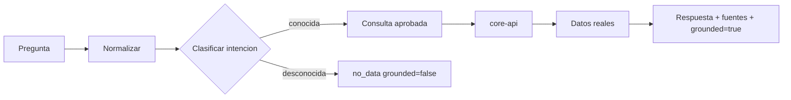

# Asistente generativo (GenAI)

- **Tarea:** T12
- **Servicio:** `services/genai`
- **Puerto:** 8003
- **Dependencia:** `core-api` (8000); sin conexion a SQL Server
- **Evidencia:** `documentation/evidencias/T12_genai.md`

---

## 1. Objetivo y alcance

Permitir que un usuario pregunte en lenguaje natural por las ventas y reciba una
respuesta **respaldada por datos**, con la fuente declarada. El asistente no
ejecuta SQL libre, no se conecta a SQL Server y no inventa cifras.

Alcance actual: 10 consultas de negocio aprobadas mas un rechazo explicito
(`no_data`) para preguntas fuera de alcance.

## Interfaz grafica

El dashboard incluye la pagina **Asistente de ventas** en <http://localhost:8501>.
Las preguntas de ventas se envian a `POST /ask` en GenAI y presentan `grounded`
y sus fuentes. Las preguntas generales se responden en un modo separado con
Ollama local, configurado por `OLLAMA_URL`, `OLLAMA_MODEL` y
`OLLAMA_HTTP_TIMEOUT`; estas respuestas se identifican como no verificadas.
Ninguno de los clientes del dashboard se conecta directamente a SQL Server.

---

## 2. Como se evita inventar datos

1. **Normalizacion determinista:** minusculas, sin acentos ni espacios extra.
2. **Clasificacion por reglas:** `app/intents.py` mapea la pregunta a una
   intencion conocida; no hay generacion libre de texto.
3. **Consulta fija:** cada intencion llama a un endpoint concreto de `core-api`.
4. **Respuesta armada con los datos recibidos:** los numeros salen del JSON de la
   API, no del modelo de lenguaje.
5. **Rechazo explicito:** si no hay intencion o no hay datos, responde
   `grounded=false`, `datos={}` y `fuentes=[]`.
6. **Fuente declarada:** toda respuesta incluye servicio, endpoint y
   `data_updated_at`.



---

## 3. Catalogo de consultas aprobadas

| Intención | Ruta API | Ejemplo |
|---|---|---|
| `ventas_totales` | `GET /api/v1/kpis` | cuanto vendimos en total |
| `facturas` | `GET /api/v1/kpis` | cuantas facturas hay |
| `ticket_promedio` | `GET /api/v1/kpis` | cual es el ticket promedio |
| `unidades` | `GET /api/v1/kpis` | cuantas unidades se vendieron |
| `top_productos` | `GET /api/v1/agrupado?dimension=producto` | ranking de productos |
| `ventas_por_local` | `GET /api/v1/agrupado?dimension=local` | ventas por local |
| `ventas_por_seccion` | `GET /api/v1/agrupado?dimension=seccion` | ventas por seccion |
| `ventas_por_producto` | `GET /api/v1/kpis?producto=...` | cuanto vendio Mini Lorito |
| `tendencia` | `GET /api/v1/tendencias?granularidad=mes` | tendencia mensual |
| `comparacion` | `GET /api/v1/kpis` (dos periodos) | comparar 2007 vs 2008 |
| `no_data` | (ninguno) | preguntas fuera de alcance |

---

## 4. Contratos

| Metodo | Ruta | Descripcion |
|---|---|---|
| POST | `/ask` | Responde una pregunta con datos y fuentes |
| GET | `/queries` | Catalogo de consultas aprobadas |
| GET | `/tests` | Las 10 pruebas documentadas |
| POST | `/tests/run` | Ejecuta las pruebas y resume |
| GET | `/health` | Estado del servicio y de `core-api` |

Respuesta valida:

```json
{
  "pregunta": "ventas por local",
  "intent": "ventas_por_local",
  "respuesta": "Ventas por local del periodo completo: VIVANDA BENAVIDES S/ 339.00; ...",
  "datos": {"grupos": []},
  "fuentes": [
    {"servicio": "core-api", "endpoint": "/api/v1/agrupado?dimension=local", "data_updated_at": "..."}
  ],
  "grounded": true,
  "interpretacion": ""
}
```

Respuesta fuera de alcance:

```json
{
  "pregunta": "quien gano el mundial",
  "intent": "no_data",
  "respuesta": "No puedo responder esa pregunta con los datos de ventas disponibles.",
  "datos": {},
  "fuentes": [],
  "grounded": false
}
```

---

## 5. Pruebas

`python -m app test` ejecuta 10 casos: 9 consultas con datos y 1 rechazo. Cada
caso valida que la intencion sea la esperada, que la respuesta no este vacia y
que `grounded` corresponda. Resultado real: **10/10 OK**.

`POST /tests/run` expone el mismo resultado por HTTP para la demo.

---

## 6. Ollama para conversacion general

Instala Ollama, inicia el servicio local y descarga el modelo configurado:

```powershell
ollama serve
ollama pull llama3.2:1b
```

La interfaz mantiene modos separados para ventas verificadas y conversacion
general. El modo general no consulta GenAI y bloquea preguntas claramente
relacionadas con ventas; el modo de ventas nunca delega sus preguntas a Ollama.
Asi, una pregunta de ventas fuera del catalogo conserva el rechazo determinista
y no se presentan cifras generadas.

## 7. Limites

| Limite | Consecuencia |
|---|---|
| Catalogo de ventas cerrado | Las consultas de ventas no reconocidas se rechazan |
| Ollama local opcional | Las preguntas generales requieren el servicio y el modelo local |
| Solo 10 intenciones | Una pregunta nueva fuera del catalogo se rechaza |
| Depende de `core-api` | Si la API cae, responde 503 y no inventa datos |
| Memoria limitada | El modo de ventas no conserva contexto; Ollama recibe solo los ultimos 6 mensajes generales |
| Periodo completo por defecto | No interpreta rangos arbitrarios que no esten en el catalogo |

Agregar una consulta requiere: nueva intencion en `app/intents.py`, nueva entrada
en `app/query_catalog.py` y `app/queries.py` usando un endpoint existente; agrega
o actualiza el caso correspondiente en `app/checks.py`.
Nunca se agrega un endpoint que reciba SQL.
