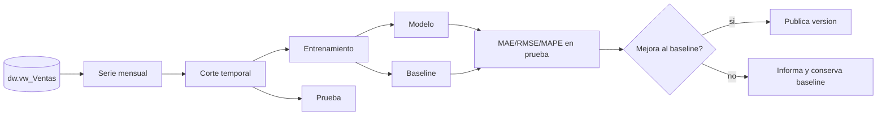

# Modelo predictivo (ML)

- **Tarea:** T11
- **Servicio:** `services/ml`
- **Puerto:** 8002
- **Fuente:** `dw.vw_Ventas` (solo lectura)
- **Evidencia:** `documentation/evidencias/T11_ml.md`

---

## 1. Objetivo

Proyectar ventas mensuales con un modelo simple, versionado y **evaluado fuera de
muestra**, comparado contra un baseline obligatorio. El objetivo no es acertar el
futuro, sino demostrar un proceso metodologicamente correcto y honesto con los
datos disponibles.

---

## 2. Estado real con la fuente actual

La fuente `Venta` tiene ventas en **un solo mes** (2008-08, S/ 696.40). No existe
historico para dividir en entrenamiento y prueba. El servicio responde:

```json
GET /model
{
  "status": "insufficient_data",
  "message": "Se necesitan al menos 8 meses con ventas para dividir en entrenamiento y prueba; hay 1. No se publican metricas.",
  "version": null,
  "train_periods": 0,
  "test_periods": 1
}
```

Decisiones asociadas:

- **No** se publican MAE/RMSE/MAPE si no hay bloque de prueba.
- **No** se proyectan cifras: `POST /predict` devuelve **409** mientras no haya
  modelo entrenado.
- Las metricas del algoritmo se verifican con una **serie sintetica** en
  `tests/test_ml_model.py`, y se identifican como tales (no son resultados del
  negocio).

---

## 3. Diseno de la evaluacion

| Decision | Implementacion |
|---|---|
| Division | Temporal: el bloque de prueba son los ultimos meses; nunca aleatoria |
| Minimos | `ML_MIN_TRAIN_PERIODS=6`, `ML_MIN_TEST_PERIODS=2` (8 meses en total) |
| Baseline | Naive estacional (mismo mes del anio anterior) con 12+ meses; naive simple si no |
| Modelo | Regresion lineal sobre tendencia + estacionalidad seno/coseno del mes |
| Metricas | MAE, RMSE y MAPE calculadas **solo** en el bloque de prueba |
| Sin leakage | El modelo no ve el bloque de prueba; no se usan variables del futuro |
| Versionado | `artifacts/model.joblib` + metadata con version, parametros y periodos |
| Registro | Cada corrida queda en `audit.ml_experiment` |



---

## 4. Contratos

| Metodo | Ruta | Descripcion |
|---|---|---|
| GET | `/model` | Estado, version, parametros y periodos |
| GET | `/metrics` | Metricas de prueba del modelo y del baseline |
| GET | `/series` | Serie mensual observada |
| POST | `/predict` | Proyeccion de N meses (409 si no hay modelo) |
| POST | `/train` | Entrena, evalua, guarda y registra el experimento |
| GET | `/health` | Estado del servicio y filas disponibles |

Ejemplo de respuesta con modelo entrenado:

```json
GET /metrics
{
  "status": "trained",
  "evaluated_on": "test",
  "train_periods": 18,
  "test_periods": 6,
  "results": [
    {"modelo": "baseline", "mae": 480.0, "rmse": 505.2, "mape": 32.4},
    {"modelo": "regresion_lineal_tendencia_estacional", "mae": 38.9, "rmse": 44.66, "mape": 2.9}
  ]
}
```

`evaluated_on: "test"` es explicito: ninguna metrica corresponde a entrenamiento.

---

## 5. Verificacion del algoritmo

`tests/test_ml_model.py` usa dos series controladas:

| Caso | Datos | Resultado |
|---|---|---|
| 1 | 24 meses sinteticos | `trained`, 18/6 periodos, MAE 38.9 vs baseline 480.0, 6 predicciones |
| 2 | 1 mes | `insufficient_data`, metricas `null`, sin prediccion |

Las cifras del caso 1 **no** se presentan como resultado del negocio: solo
prueban que el corte, el baseline y las metricas funcionan.

---

## 6. Limites y riesgos

| Limite | Consecuencia |
|---|---|
| Un solo mes en la fuente | No hay modelo entrenado ni predicciones reales |
| Serie corta | Aunque hubiera 8 meses, la estacionalidad anual no seria estimable |
| Sin variables exogenas | El modelo solo captura tendencia y estacionalidad |
| Cambios de surtido o precios | El modelo no los anticipa |
| Uso de la prediccion | Es una estimacion con supuestos; no reemplaza el criterio del negocio |

---

## 7. Reproduccion

```powershell
cd services/ml
python -m pip install -r requirements.txt
python -m app train          # informa insufficient_data con la fuente actual
python -m app status
python -m app series
uvicorn app.main:app --port 8002
```

```powershell
python tests/test_ml_model.py
```

Artefactos aislables con `ML_ARTIFACTS_DIR` (util en pruebas para no pisar la
version vigente).
