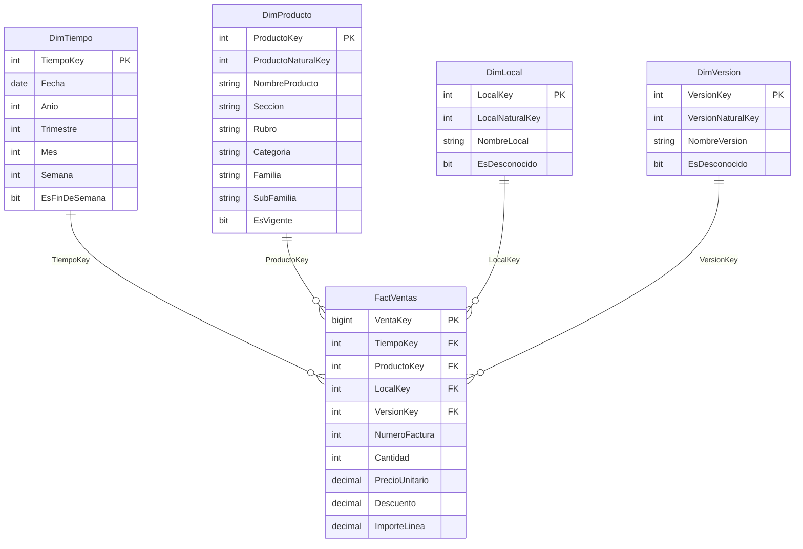

# Modelo dimensional - Data Warehouse de Ventas

- **Tarea:** T07
- **Esquema:** `dw`
- **Script:** `database/02_dw.sql`
- **Diagrama editable:** `modelo_dimensional.dbml` (dbdiagram.io) y Mermaid al final

---

## 1. Grano declarado

> **Una fila de `dw.FactVentas` representa una linea de factura de venta.**
> Es decir, un producto vendido, en una cantidad y precio, dentro de una factura,
> en una fecha, en un local y bajo una version de sistema.

Consecuencias del grano:

- `Cantidad` e `ImporteLinea` son **aditivas** entre todas las dimensiones.
- El total de una factura se obtiene con `SUM(ImporteLinea) GROUP BY NumeroFactura`.
- Nunca se agrega `PrecioUnitario` (no aditiva).
- Una factura con 3 lineas produce 3 filas de hecho.

---

## 2. Esquema estrella



---

## 3. Dimensiones

### 3.1 `dw.DimTiempo`

Clave sustituta: `TiempoKey` con formato `AAAAMMDD` (entero legible, sin IDENTITY,
porque el calendario es determinista). Rango cargado: `2000-01-01` a `2035-12-31`.
Miembro desconocido: `TiempoKey = 0` (`1900-01-01`).

Atributos: fecha, anio, trimestre, mes, nombre de mes, semana ISO, dia, nombre de dia,
dia del anio, fin de semana, anio-mes (`AAAAMM`) para agrupaciones rapidas.

### 3.2 `dw.DimProducto`

Clave natural: `idProducto`. Clave sustituta: `ProductoKey` (IDENTITY).

Contiene la jerarquia comercial completa aplanada:
`Seccion > Rubro > Categoria > Familia > SubFamilia > Producto`, mas una columna
`JerarquiaCompleta` para filtros y busqueda.

### 3.3 `dw.DimLocal`

Clave natural: `IdLocal`. Representa el punto de venta (rol geografico del modelo,
ya que la fuente no tiene tabla de geografia).

### 3.4 `dw.DimVersion`

Clave natural: `IdVersion`. Version del sistema que registro la venta; permite
comparar comportamiento entre versiones.

### 3.5 Miembro desconocido

Cada dimension tiene la fila con clave `0`:

| Dimension | Valores del miembro 0 |
|---|---|
| `DimTiempo` | 1900-01-01, "Desconocido" |
| `DimProducto` | "Producto desconocido", `EsDesconocido = 1` |
| `DimLocal` | "Local desconocido", `EsDesconocido = 1` |
| `DimVersion` | "Version desconocida", `EsDesconocido = 1` |

Regla: si un hecho no encuentra su dimension, se carga con clave `0` y **ademas**
se registra en cuarentena para revision. Nunca se descarta el hecho en silencio.

---

## 4. Tabla de hechos

### `dw.FactVentas`

| Columna | Tipo | Rol |
|---|---|---|
| `VentaKey` | bigint identity | PK |
| `TiempoKey` | int | FK DimTiempo |
| `ProductoKey` | int | FK DimProducto |
| `LocalKey` | int | FK DimLocal |
| `VersionKey` | int | FK DimVersion |
| `NumeroFactura` | int | atributo degenerado (cabecera) |
| `Cantidad` | int | medida aditiva |
| `PrecioUnitario` | decimal(18,2) | medida NO aditiva |
| `Descuento` | decimal(18,2) | medida aditiva |
| `ImporteLinea` | decimal(18,2) | medida aditiva = Cantidad * PrecioUnitario - Descuento |

`NumeroFactura` es una **dimension degenerada**: vive en la tabla de hechos porque
no tiene atributos propios mas alla del identificador.

### 4.1 Clasificacion de medidas

| Medida | Clase | Explicacion |
|---|---|---|
| `Cantidad` | Aditiva | Suma correcto por cualquier dimension |
| `ImporteLinea` | Aditiva | Suma correcto por cualquier dimension |
| `Descuento` | Aditiva | Suma correcto por cualquier dimension |
| `PrecioUnitario` | No aditiva | Promediar precios requiere ponderar por cantidad |
| `TicketPromedio` | Derivada, no aditiva | `SUM(ImporteLinea) / COUNT(DISTINCT NumeroFactura)` |
| `UnidadesPorFactura` | Derivada | `SUM(Cantidad) / COUNT(DISTINCT NumeroFactura)` |

### 4.2 Constraint de coherencia

```sql
CHECK (ImporteLinea = Cantidad * PrecioUnitario - Descuento)
```

Si la fuente trae una linea incoherente, la regla de calidad la rechaza antes de
llegar al DW (no se "corrige" el importe en silencio).

---

## 5. Estrategia SCD

**Tipo 1** (sobrescribir atributos, sin historial).

Justificacion: la fuente no publica historial de cambios ni `UpdatedAt` en las
dimensiones; construir un Tipo 2 implicaria inventar vigencias. Ademas, los
atributos descriptivos de producto y local cambian poco y el analisis del periodo
no depende de su estado historico.

Evolucion prevista a Tipo 2: las dimensiones ya incluyen `FilaDesde`, `FilaHasta`
y `EsVigente`, de modo que el cambio se limita a la logica de carga. Se documenta
como limitacion conocida.

---

## 6. Claves e indices

- Clave sustitutas: `IDENTITY(1,1)` por dimension; el miembro desconocido usa `0`
  con `SET IDENTITY_INSERT ON`.
- Clave natural conservada y con indice unico en cada dimension.
- PK clustered en `FactVentas(VentaKey)`.
- Indices nonclustered en las cuatro FKs del hecho y en `NumeroFactura`.
- FK fisicas del hecho hacia las dimensiones (garantizan cero huerfanos).

---

## 7. Diccionario resumido del DW

| Tabla | Filas esperadas | Origen |
|---|---|---|
| `DimTiempo` | ~13.000 (2000-2035) | Generada |
| `DimProducto` | = productos + 1 | `clean.Producto` + jerarquia |
| `DimLocal` | = locales + 1 | `clean.Local` |
| `DimVersion` | = versiones + 1 | `clean.Version` |
| `FactVentas` | = lineas de factura validas | `ready.Ventas` |

---

## 8. Desviaciones respecto de la plantilla de la consigna

| Plantilla T07 | Implementado | Motivo |
|---|---|---|
| `DimCustomer` | No | La fuente `Venta` no tiene clientes |
| `DimEmployee` | No | La fuente `Venta` no tiene empleados/vendedores |
| `DimGeography` | `DimLocal` | El unico atributo geografico disponible es el local |
| `Discount` | Si (default 0) | La fuente no registra descuentos; columna lista para cuando exista |

Estas ausencias se declaran como **no-alcance por fuente**, no como recorte.

---

## 9. Criterios de aceptacion (T07)

- [x] Grano declarado y documentado.
- [x] Star schema implementado en SQL Server.
- [x] Claves sustitutas + clave natural conservada.
- [x] `DimTiempo` con atributos de calendario.
- [x] Politica de dimension desconocida definida y aplicada.
- [x] Estrategia SCD documentada (Tipo 1, con evolucion a Tipo 2).
- [x] Medidas aditivas, semi-aditivas y no aditivas identificadas.
